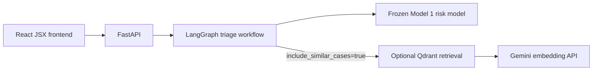

# ResolveIQ

ResolveIQ is a local NYC 311 heat and hot-water triage workbench. It helps a service manager inspect a new complaint in two ways:

1. It scores the request with a frozen tabular model for slow-resolution risk.
2. On explicit request, it retrieves similar historical complaints from a versioned Qdrant collection.

The result is a transparent workflow, not an automated dispatch decision. The score is an uncalibrated ranking score, and the historical cases are evidence to inspect rather than guaranteed precedents.

## What It Does

The React JSX interface collects controlled complaint fields and an NYC local intake time. It derives the intake hour, weekday, and weekend flag, then sends one request to `POST /api/triage`.

The backend runs a deterministic LangGraph workflow:



Risk scoring always happens first. Retrieval is bypassed unless the caller checks the similar-cases option. Borough is excluded from Model 1 and is used only as an optional Qdrant filter.

ResolveIQ does **not** generate chatbot answers, use a ReAct loop, or make an operational review decision.

## Local Setup

### Requirements

- Windows-compatible shell
- Python `>=3.14`
- `uv`
- Docker Desktop with Docker Compose
- A Gemini API key if you want to run live similar-case retrieval

The Python dependencies and versions are declared in `pyproject.toml` and `uv.lock`.

Copy `.env.example` to a root `.env` file, then add your own Gemini key if you want live retrieval. In PowerShell:

```powershell
Copy-Item .env.example .env
```

Compose expects `.env` to exist even when you are only using local scoring. Do not commit `.env` or API keys. The application also supports the settings declared in `src/resolveiq/config.py`, including `GEMINI_MODEL`, `GEMINI_EMBED_MODEL`, `QDRANT_URL`, and `QDRANT_COLLECTION_CASES`.

### Start the local application

From the repository root:

```text
uv sync
docker compose up --build -d
```

The Makefile includes the main local checks and stack commands:

```text
make run-docker-compose
make ps
make logs
make test
make frontend-build
make compose-check
make down
```

The Compose stack contains three services:

| Service | Local address | Role |
| --- | --- | --- |
| `frontend` | `http://127.0.0.1:5173` | React build served by nginx |
| `api` | `http://127.0.0.1:8000` | FastAPI service |
| `qdrant` | `http://localhost:6333` | Historical-case vector store |

The API container reaches Qdrant by the Compose service name, `http://qdrant:6333`. Host-side notebooks and local Python processes use `http://localhost:6333`.

Open the workbench at `http://127.0.0.1:5173`. The API documentation is at `http://127.0.0.1:8000/docs`.

`make down` (or the Compose command below) stops the stack without deleting the Qdrant data directory:

```text
docker compose down
```

Qdrant storage is bind-mounted at `data/qdrant`. The model and labelled artifacts mounted into the API container are read-only.

## API Surface

| Method | Route | Purpose |
| --- | --- | --- |
| `GET` | `/health` | Process health and API version |
| `GET` | `/api/heat-weeks` | Recorded event-week versus quiet-week report |
| `POST` | `/api/score-intake` | Score intake features with frozen Model 1 |
| `POST` | `/api/cases/similar` | Retrieve historical cases directly |
| `POST` | `/api/triage` | Run score-first triage with optional retrieval |

`POST /api/triage` returns the risk score, frozen cutoff indicator, model disclaimer, routing decision, similar cases, and retrieval status.

### Retrieval status

The optional retrieval result is explicit:

- `not_requested`: scoring ran and retrieval was bypassed. `similar_cases` is `null`.
- `succeeded`: retrieval ran successfully. `similar_cases` is a list, including `[]` when no admissible cases matched.
- `unavailable`: a transient network, timeout, or retryable provider/server failure occurred. The risk score is still returned and `similar_cases` is `null`.
- `failed`: a non-retryable request, authentication, validation, or configuration failure occurred. The risk score is still returned and `similar_cases` is `null`.

The user-facing retrieval messages are deliberately safe and do not expose provider responses, credentials, stack traces, or connection details. Invalid request input remains a client error, normally HTTP `422`.

## Evidence And Evaluation

### Frozen risk model

Model 1 is a Logistic Regression pipeline trained on intake-time features. It excludes borough from risk scoring. Its frozen metadata records:

- Model name: `frozen_model_1_no_borough`
- Operating cutoff: `0.28`
- Calibration: `false`
- Evaluation scope: the 2023-2024 heating-season cohort

The recorded aggregate evaluation reports Model 1 validation ROC-AUC `0.6385` and PR-AUC `0.2202`. The recorded final test report shows ROC-AUC `0.6139`, PR-AUC `0.1397`, and 41.4% of final-test intake above the `0.28` cutoff. These are historical project results; the sealed test rows were not used for this README.

The project also contains a frozen manager-question reference set with 14 questions, 71 expected values, and 4 refusals. It validates previously published historical analytics from local artifacts. It is not a chatbot evaluation and is not a direct evaluator for the `/api/triage` response.

### Retrieval evidence

Qdrant collection-01 contains 798 vectors representing six canonical complaint shapes. The embedding text uses complaint type, location type, descriptor, and secondary descriptor. Borough is stored as payload and can be filtered separately; `incident_zip` is excluded.

In the recorded exploratory eight-query pilot, the decoupled borough design achieved Shape Hit@1 of `7/8` (`87.5%`) versus `4/8` (`50.0%`) for the comparison design. Shape Hit@3 was `8/8` under both designs. This is a small exploratory retrieval result, not a production-quality benchmark.

### LangSmith tracing and smoke evaluation

The LangGraph workflow is traced to LangSmith with request inputs and raw node outputs hidden. After the graph finishes, the app patches the root run with only allowlisted operational fields: whether the frozen cutoff was crossed, the routing decision, retrieval status, the number of returned cases, and counts by canonical shape. It does not include the score itself, borough, timestamps, ticket identifiers, or case outcomes.

The hosted dataset `resolveiq-triage-retrieval-smoke-v2` contains 12 synthetic canonical-shape examples. Its recorded experiment has 12 runs and three deterministic evaluators: `shape_hit_at_1`, `shape_hit_at_5`, and `workflow_safety_contract`. Each evaluator scored `1.0` on all 12 examples, with no evaluator errors.

Interpret this strictly as an integration smoke test. The expected labels are derived from the same six-shape descriptor catalog used to construct these canonical inputs; the results verify that the workflow, borough filter, and temporal-safety checks run together, not independent or representative retrieval quality. This project does not generate natural-language answers or collect operator feedback. RAGAS is therefore not used for the current structured-retrieval workflow.

## Historical-Case Time Protections

Similar cases are admitted only when:

```text
created_date < intake_time
```

Outcome fields (`status`, `closed_date`, and `resolution_description`) are exposed only when:

```text
closed_date < intake_time
```

Equality does not qualify. Cases created after or exactly at intake are excluded. Cases that were not closed before intake have their outcome fields masked. Ambiguous local daylight-saving timestamps are handled conservatively.

## Cautions And Limits

- The risk score is an uncalibrated ranking score, not a probability.
- The `0.28` cutoff is a frozen validation reference, not an operational dispatch or review decision.
- The project does not claim production readiness, fairness, causal effects, or proven public-service impact.
- The model results cover one 2023-2024 heating season and do not establish cross-season generalization.
- Retrieval evidence comes from a small exploratory pilot and can miss fine-grained complaint distinctions.
- Historical labels include explicit treatment of open tickets, clock anomalies, and non-standard statuses; those choices limit interpretation.
- Borough is intentionally excluded from risk scoring but remains available for retrieval filtering. Similar selection rates do not prove the model is fair.
- Live retrieval depends on Gemini embeddings and a running local Qdrant collection; scoring and retrieval are separate workflow steps.
- ResolveIQ is a local portfolio workbench, not a public service or an automated case-management system.

## Project Learning Path

The implementation follows the tutor workflow used for this project:

1. Explore and prepare data in notebooks.
2. Define labels and evaluate a baseline on development data.
3. Freeze the model artifact and move proven scoring logic into `src/resolveiq/`.
4. Build and test retrieval with temporal and privacy safeguards.
5. Expose the deterministic workflow through FastAPI.
6. Connect the React JSX frontend and local Docker Compose services.
7. Trace the workflow and run deterministic, explicitly limited smoke evaluations in LangSmith.

The notebooks document experiments and evidence. The backend is the production-shaped implementation for this local portfolio project; it is intentionally kept deterministic and does not add an LLM answer-generation layer.
